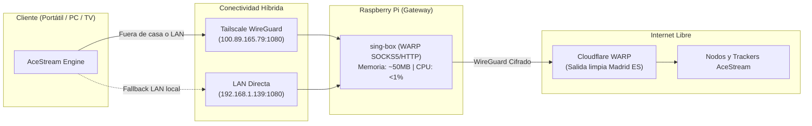

# AceStream WARP Bridge 🛡️📡

> Pasarela Proxy Anti-Censura para AceStream sobre Raspberry Pi + Cloudflare WARP + Tailscale Mesh.

[](https://tailscale.com)
[](https://cloudflare.com)
[](https://sing-box.sagernet.org)
[](LICENSE)

---

## 💡 El Problema

En España, las principales operadoras de telecomunicaciones (Telefónica, DIGI, Vodafone, Orange) aplican **bloqueos dinámicos de IP y BGP null-routing** durante la emisión de partidos de fútbol (LaLiga / Champions League).

Aunque se disponga de una **suscripción activa de AceStream Premium**, la operadora censura las direcciones IP de los emisores y trackers en tiempo real, congelando la señal a los pocos minutos (*"Connecting to peers 0%" / Prebuffering*).

---

## 🚀 La Solución: Arquitectura Híbrida

Este proyecto convierte cualquier **Raspberry Pi** (incluso una modesta RPi 2 con 1 GB de RAM) en un **Gateway Proxy SOCKS5/HTTP ultraligero** que saca el tráfico de AceStream a través de la red troncal de **Cloudflare WARP**:



### ✨ Características Principales
- **Zero-Censura:** DIGI y otras operadoras solo ven paquetes cifrados estándar contra servidores de Cloudflare; es imposible aplicar bloqueo dinámico de IPs.
- **Aislamiento por Proceso:** **Solo AceStream** pasa por el proxy. El resto del sistema operativo (navegadores, juegos, descargas) navega al 100% por tu fibra óptica habitual.
- **Fallback Automático Inteligente:** Si la Raspberry Pi está apagada, el lanzador detecta el timeout en 600 ms y arranca AceStream en modo directo (sin proxy) para que nunca te quedes colgado.
- **Movilidad Total vía Tailscale:** Funciona tanto en el sofá de tu casa (conmutación automática LAN P2P) como si viajas con el portátil a un hotel, oficina o usando datos móviles 4G/5G.
- **Consumo Mínimo:** Consume apenas 55 MB de RAM en la Raspberry Pi y 0% de CPU en reposo.

---

## 📁 Estructura del Repositorio

```text
acestream-warp-bridge/
├── README.md                          # Este documento
├── .gitignore                         # Higiene estricta de secretos y claves WireGuard
├── rpi/
│   ├── config.json.template           # Plantilla de configuración de sing-box para WARP
│   ├── install-rpi-service.sh         # Script de despliegue automatizado en Raspberry Pi
│   └── warp-proxy.service             # Unidad de servicio systemd
├── windows/
│   ├── launch_acestream.bat           # Lanzador inteligente con auto-detección y fallback
│   ├── launch_acestream_silent.vbs    # Ejecutor silencioso (sin ventana CMD al iniciar sesión)
│   ├── Reiniciar AceStream (WARP).bat # Acceso directo de escritorio para reconexión manual
│   ├── Comprobar Conexion RPi.bat     # Diagnóstico integral de conectividad RPi, WARP y sockets
│   └── install-windows-autostart.ps1  # Script PowerShell para registrar el arranque en Windows
└── docs/
    └── troubleshooting.md             # Guía paso a paso para depuración y diagnóstico
```

---

## 🛠️ Instalación y Puesta en Marcha

### 1. En la Raspberry Pi
Clonar y ejecutar el instalador desatendido:
```bash
git clone https://github.com/hvepo/acestream-warp-bridge.git
cd acestream-warp-bridge/rpi
chmod +x install-rpi-service.sh
./install-rpi-service.sh
```

El servicio `warp-proxy.service` quedará habilitado en el arranque y escuchando en el puerto `1080` tanto en la IP local (`192.168.1.139`) como en tu IP fija de **Tailscale (`100.89.165.79`)**.

### 2. En Windows (Portátil / PC)

#### Opción A: En tu portátil o nuevo equipo (Instalación automática en 1 línea)
Abre PowerShell y pega este comando:
```powershell
irm https://raw.githubusercontent.com/hvepo/acestream-warp-bridge/main/windows/install-remote.ps1 | iex
```

#### Opción B: Si ya tienes el repositorio descargado
Simplemente haz doble clic en el archivo:
```text
actualizar_y_activar.bat
```
(O ejecuta `.\windows\install-windows-autostart.ps1` desde PowerShell).

Esto dejará configurado:
1. Copia de lanzadores a `%APPDATA%\ACEStream\engine\`.
2. Inicio silencioso en el registro de Windows (`HKCU\...\Run\AceStream`).
3. Accesos directos **`Reiniciar AceStream (WARP)`** y **`Comprobar Conexion RPi`** en tu Escritorio.

---

## 🧪 Verificación Rápida

Para verificar que el proxy está activo y saliendo por Cloudflare:
```bash
curl -s -x socks5h://100.89.165.79:1080 https://cloudflare.com/cdn-cgi/trace | grep warp=
# Resultado esperado: warp=on
```

---

## 📄 Licencia

Distribuido bajo la licencia [MIT](LICENSE).
