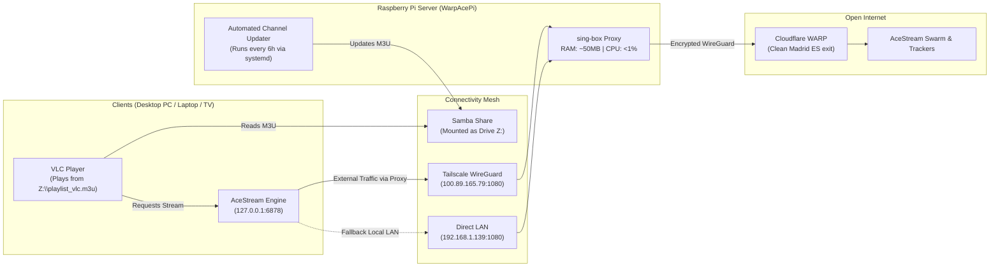

# WarpAcePi 🛡️📡

> Comprehensive Anti-Censorship Gateway & Automated M3U Playlist Manager for AceStream on Raspberry Pi + Cloudflare WARP + Tailscale Mesh.

[](https://tailscale.com)
[](https://cloudflare.com)
[](https://sing-box.sagernet.org)
[](https://python.org)
[](LICENSE)

---

## 💡 The Problem

In Spain and across Europe, major ISPs (DIGI, Telefónica, Vodafone, Orange) enforce **dynamic IP blocking and BGP null-routing** during major sporting events (LaLiga, Champions League).

Even with an active AceStream Premium subscription, ISP DPI (Deep Packet Inspection) censors tracker and peer IP addresses in real time, freezing the stream within minutes (*"Connecting to peers 0%" / Prebuffering loop*).

---

## 🚀 The Solution: WarpAcePi

**WarpAcePi** merges lightweight anti-censorship routing with an autonomous channel catalog & playlist distribution server:

1. **Anti-Censorship Gateway (Raspberry Pi):** An ultra-lightweight SOCKS5/HTTP proxy (`sing-box`) routing AceStream traffic through the **Cloudflare WARP** backbone via WireGuard.
2. **Autonomous Playlist Generator:** Automated scraping, validation, and compiling of verified M3U/M3U8 playlists for VLC and AcePlayer.
3. **Automated Network Drive (Drive Z:):** Samba service sharing playlists across your LAN and Tailscale mesh, automatically mounted as network drive `Z:` on Windows.
4. **Clean Windows Client Tools:** Zero desktop pollution scripts with automatic port isolation (`48621` on desktop, `48622` on laptop) and fixed HTTP loopback API (`127.0.0.1:6878`).



---

## 📁 Repository Structure

```text
WarpAcePi/
├── README.md                            # Complete documentation
├── requirements.txt                     # Python dependencies (requests)
├── update_and_activate.bat              # 1-click Windows installer and updater
├── update_channels.bat                  # Manual channel scraper and M3U compiler
├── data/
│   ├── channels.json                    # Structured channel catalog & metadata
│   ├── sources.json                     # External web scrapers and portals
│   └── hashes_acestream.m3u             # Extracted content IDs
├── playlists/                           # Master playlists (shared as Drive Z:)
│   ├── playlist_vlc.m3u                 # Optimized for VLC (http://127.0.0.1:6878/...)
│   ├── playlist_direct.m3u              # Native acestream:// links (Ace Player)
│   ├── playlist_http.m3u                # Standard HTTP proxy links
│   └── working_streams_vlc_NOW.m3u      # Verified live working streams
├── scripts/
│   ├── evaluate_and_update.py           # Web scraper, live stream validator & compiler
│   ├── build_playlist.py                # M3U playlist builder
│   ├── check_streams.py                 # SHA-1 hash validator
│   └── import_m3u.py                    # Import existing M3U files into catalog
├── rpi/
│   ├── install-rpi-service.sh           # Raspberry Pi WARP proxy installer
│   ├── setup-rpi-services.sh            # Samba share (Z:) + systemd update timer
│   ├── config.json.template             # sing-box WARP configuration template
│   └── warp-proxy.service               # systemd unit for WARP proxy
└── windows/
    ├── restart_acestream_warp.bat       # Restart AceStream with WARP shield & port 6878
    ├── check_rpi_connection.bat         # Diagnostics for RPi, WARP, Tailscale & sockets
    ├── connect_z_drive_rpi.bat          # 1-click mapper for Drive Z: (RPi Samba)
    ├── laptop_diagnostic_repair.bat     # Diagnostic & repair tool for Windows clients
    ├── launch_acestream.bat             # Auto-detecting smart launcher with fallback
    ├── launch_acestream_silent.vbs      # Silent login-time launcher
    └── install-windows-autostart.ps1    # Registry auto-start installer
```

---

## 🛠️ Quick Start

### 1. On Raspberry Pi

Run the automated installer:
```bash
git clone https://github.com/hvepo/acestream-warp-bridge.git WarpAcePi
cd WarpAcePi/rpi

# 1. Install WARP Proxy (sing-box on port 1080)
chmod +x install-rpi-service.sh setup-rpi-services.sh
./install-rpi-service.sh

# 2. Setup Samba (Drive Z:) and automatic 6-hour playlist updater
./setup-rpi-services.sh
```

### 2. On Windows Clients (Desktop & Laptop)

#### Option A: One-line remote install (PowerShell)
```powershell
irm https://raw.githubusercontent.com/hvepo/acestream-warp-bridge/main/windows/install-remote.ps1 | iex
```

#### Option B: From cloned repository
Simply double-click:
```text
update_and_activate.bat
```

This will automatically configure:
1. Silent startup entry with WARP shield at Windows login.
2. Tools ready inside `windows/` folder (desktop remains 100% clean).
3. Connect Drive `Z:` by running `windows\connect_z_drive_rpi.bat`.

---

## ⚙️ Multi-Device Port Configuration

When streaming on multiple computers behind the same home router:

| Device | AceStream Options -> Port (P2P) | Local VLC HTTP API | Destination Proxy |
| :--- | :---: | :---: | :---: |
| **Desktop PC** | **`48621`** | `127.0.0.1:6878` | `100.89.165.79:1080` (RPi) |
| **Laptop** | **`48622`** | `127.0.0.1:6878` | `100.89.165.79:1080` (RPi) |

> [!TIP]
> Each computer must have a unique P2P port in AceStream Options to avoid router UPnP port collisions. Both computers use the standard local port `6878` for VLC compatibility.

---

## 🧪 Verification & Diagnostics

To verify the proxy status and Cloudflare WARP exit node:
```bash
curl -s -x socks5h://100.89.165.79:1080 https://cloudflare.com/cdn-cgi/trace | grep warp=
# Expected output: warp=on
```

On Windows, run:
```cmd
windows\check_rpi_connection.bat
```

---

## 📄 License

Distributed under the [MIT](LICENSE) License.
