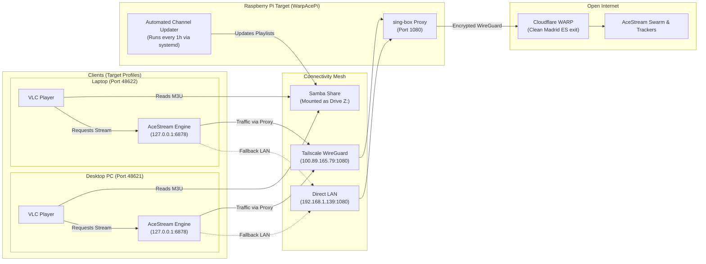

# WarpAcePi 🛡️📡

> Comprehensive Anti-Censorship Gateway & Automated M3U Playlist Manager for AceStream on Raspberry Pi + Cloudflare WARP + Tailscale Mesh.
> Built with dedicated target profiles (`targets/desktop/`, `targets/laptop/`, `targets/rpi/`) and a strict **Zero Desktop Pollution** policy.

[](https://tailscale.com)
[](https://cloudflare.com)
[](https://sing-box.sagernet.org)
[](https://python.org)
[](LICENSE)

---

## 💡 The Problem

In Spain and across Europe, major ISPs (DIGI, Telefónica, Vodafone, Orange) enforce **dynamic IP blocking and BGP null-routing** during major sporting events (LaLiga, Champions League).

Even with an active AceStream Premium subscription, ISP DPI (Deep Packet Inspection) censors tracker and peer IP addresses in real time, freezing the stream within minutes (*"Connecting to peers 0%" / Prebuffering loop*). Running multiple devices on the same home router also leads to UPnP port collisions, packet drops on USB dock network adapters, and disconnected network drives.

---

## 🚀 The Solution: WarpAcePi

**WarpAcePi** provides a clean, target-based architecture where every device has dedicated resources:

1. **Anti-Censorship Gateway (Raspberry Pi Target):** Ultra-lightweight SOCKS5/HTTP proxy (`sing-box`) routing AceStream traffic through the **Cloudflare WARP** backbone via WireGuard on port `1080`.
2. **Autonomous Playlist Generator:** Automated scraping, validation, and compiling of verified M3U/M3U8 playlists for VLC and AcePlayer.
3. **Automated Network Drive (Drive Z:):** Samba service sharing playlists across your LAN and Tailscale mesh, automatically mounted as network drive `Z:` on Windows clients.
4. **Target-Dedicated Windows Resources:**
   - **Desktop PC (`targets/desktop/`):** Dedicated P2P port `48621`, local loopback HTTP API `127.0.0.1:6878`, silent autostart.
   - **Laptop (`targets/laptop/`):** Dedicated P2P port `48622`, dock network adapter optimization (Green Ethernet / EEE packet drop prevention), full diagnostic repair suite.
5. **Zero Desktop Policy:** No files, batch scripts, or shortcuts are placed on the Windows desktop. All scripts and tools remain strictly inside the repository.



---

## 📁 Repository Structure

```text
WarpAcePi/
├── README.md                            # Documentation and architecture guide
├── requirements.txt                     # Python dependencies (requests)
├── update_and_activate.bat              # Interactive target selector and activator
├── update_channels.bat                  # Manual channel scraper and M3U compiler
│
├── targets/                             # Dedicated resources organized by device
│   │
│   ├── desktop/                         # TARGET: Desktop PC (P2P Port 48621)
│   │   ├── activate.bat                 # 1-click installer, activator & desktop cleaner
│   │   ├── restart_acestream_warp.bat   # Restart AceStream (WARP shield, port 48621, HTTP 6878)
│   │   ├── mount_z_drive.bat            # Map RPi playlists to network drive Z:
│   │   ├── test_connection.bat          # Test RPi proxy 1080, Samba 445, local 6878
│   │   ├── uninstall_autostart.bat      # Restore original AceStream startup
│   │   ├── launch_acestream.bat         # Direct launcher with port 48621
│   │   ├── launch_acestream_silent.vbs  # Silent VBS launcher (no console window)
│   │   ├── install_autostart.ps1        # Auto-start installer + strict desktop cleaner
│   │   └── connect_rpi_z.ps1            # Network drive Z: PowerShell mapper
│   │
│   ├── laptop/                          # TARGET: Laptop (P2P Port 48622 + Dock Optimization)
│   │   ├── activate.bat                 # 1-click installer, activator, dock tuner & desktop cleaner
│   │   ├── restart_acestream_warp.bat   # Restart AceStream (WARP shield, port 48622, HTTP 6878)
│   │   ├── diagnose_and_repair.bat      # Comprehensive laptop diagnostic and repair suite
│   │   ├── optimize_network.bat         # Disable Green Ethernet / EEE on USB dock NIC
│   │   ├── mount_z_drive.bat            # Map RPi playlists to network drive Z:
│   │   ├── test_connection.bat          # Test RPi proxy 1080, Samba 445, local 6878
│   │   ├── uninstall_autostart.bat      # Restore original AceStream startup
│   │   ├── launch_acestream.bat         # Direct launcher with port 48622
│   │   ├── launch_acestream_silent.vbs  # Silent VBS launcher
│   │   ├── install_autostart.ps1        # Auto-start installer + strict desktop cleaner
│   │   ├── connect_rpi_z.ps1            # Network drive Z: PowerShell mapper
│   │   └── diagnose_laptop.ps1          # Comprehensive diagnostic script
│   │
│   └── rpi/                             # TARGET: Raspberry Pi (WARP Proxy & Playlist Server)
│       ├── setup.sh                     # Full 1-command installer (proxy + Samba + timers)
│       ├── install_warp_service.sh      # Installs sing-box WARP proxy on port 1080
│       ├── configure_samba.sh           # Configures Samba share [playlists] for drive Z:
│       ├── install_update_timer.sh      # Installs systemd timer to refresh channels every 1h
│       ├── run_channel_update.sh        # Manually refresh playlists and test streams now
│       ├── config.json.template         # sing-box WARP configuration template
│       └── warp-proxy.service           # systemd service unit
│
├── data/
│   ├── channels.json                    # Structured channel catalog & metadata
│   ├── sources.json                     # External web scrapers and portals
│   └── hashes_acestream.m3u             # Extracted content IDs
│
├── playlists/                           # Master playlists (shared as Drive Z:)
│   ├── playlist_vlc.m3u                 # Optimized for VLC (http://127.0.0.1:6878/...)
│   ├── playlist_direct.m3u              # Native acestream:// links (Ace Player)
│   ├── playlist_http.m3u                # Standard HTTP proxy links
│   └── working_streams_vlc_NOW.m3u      # Verified live working streams
│
├── scripts/
│   ├── evaluate_and_update.py           # Web scraper, live stream validator & compiler
│   ├── build_playlist.py                # M3U playlist builder
│   ├── check_streams.py                 # SHA-1 hash validator
│   └── import_m3u.py                    # Import existing M3U files into catalog
│
└── docs/
    └── troubleshooting.md               # Complete multi-device troubleshooting guide
```

---

## 🛠️ Quick Start

### 1. On Raspberry Pi Target

SSH into your Raspberry Pi and run:
```bash
git clone https://github.com/hvepo/acestream-warp-bridge.git WarpAcePi
cd WarpAcePi/targets/rpi
chmod +x setup.sh && ./setup.sh
```

This single command:
1. Installs and enables `sing-box` with Cloudflare WARP on port `1080`.
2. Sets up Samba share `[playlists]` so Windows clients can mount `Z:\`.
3. Enables systemd timer `update-acestream-playlists.timer` to refresh streams every hour.

---

### 2. On Windows Desktop PC Target

Navigate inside the cloned repository to `targets\desktop\` and run:
```text
targets\desktop\activate.bat
```
*(Or run `update_and_activate.bat` from the root and select `[1] Desktop PC`)*

**What this does:**
- Configures AceStream inbound P2P port to `48621` (UPnP mapped to Desktop `192.168.1.142`).
- Registers silent autostart with WARP shield at Windows boot.
- Maps Raspberry Pi playlists as network drive `Z:`.
- Enforces the **Zero Desktop Policy** (removes any shortcuts from Desktop; everything remains inside the repository).
- Verifies local HTTP server at `http://127.0.0.1:6878`.

---

### 3. On Windows Laptop Target

Navigate inside the cloned repository to `targets\laptop\` and run:
```text
targets\laptop\activate.bat
```
*(Or run `update_and_activate.bat` from the root and select `[2] Laptop`)*

**What this does:**
- Configures AceStream inbound P2P port to `48622` (UPnP mapped to Laptop `192.168.1.150`).
- Disables Green Ethernet / Energy Efficient Ethernet on USB Dock network adapters to prevent packet drops and stuttering.
- Registers silent autostart with WARP shield at Windows boot.
- Maps Raspberry Pi playlists as network drive `Z:`.
- Enforces the **Zero Desktop Policy**.
- Includes `targets\laptop\diagnose_and_repair.bat` for instant troubleshooting if dock or WiFi drops.

---

## ⚙️ Multi-Device Port Configuration

| Device | Inbound P2P Port | Local VLC HTTP API | Destination Proxy | Notes |
| :--- | :---: | :---: | :---: | :--- |
| **Desktop PC** | **`48621`** | `127.0.0.1:6878` | `100.89.165.79:1080` (RPi) | Ethernet (Fixed) |
| **Laptop** | **`48622`** | `127.0.0.1:6878` | `100.89.165.79:1080` (RPi) | Dock NIC tuned |
| **Raspberry Pi** | N/A | N/A | WireGuard Cloudflare WARP | Port 1080 (Proxy) + 445 (Samba) |

---

## 🛡️ Zero Desktop Pollution Guarantee

WarpAcePi strictly adheres to a **Zero Desktop Policy**:
- **No desktop shortcuts:** No `.lnk`, `.bat`, or `.vbs` files are copied or created on your Desktop or OneDrive Desktop.
- **Repository-contained tools:** All utilities reside in their respective `targets/<device>/` folders.
- **Automatic cleanup:** Any stray shortcuts from previous installations are cleaned automatically when running `activate.bat`.
